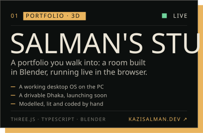
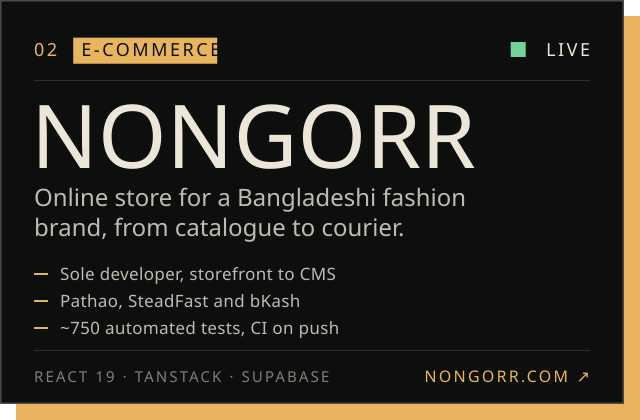
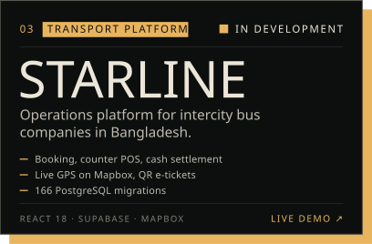
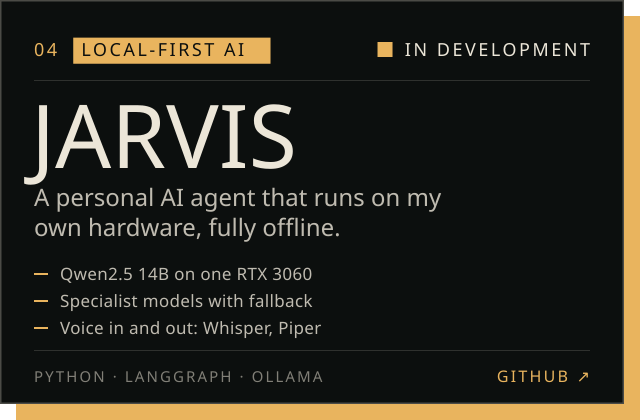

<!-- The artwork in assets/ is drawn in the design language of kazisalman.dev (dark and light versions, fonts embedded). -->

<a href="https://kazisalman.dev">
  <picture>
    <source media="(prefers-color-scheme: dark)" srcset="assets/hero-dark.svg">
    <source media="(prefers-color-scheme: light)" srcset="assets/hero-light.svg">
    
  </picture>
</a>

I'm **Kazi Salman** (Kazi Salman Salim), a software engineer in Dhaka, Bangladesh. I build full-stack web products, local-first AI and real-time 3D for the web, and I study for a B.Sc. in Computer Science at BRAC University (2023–2027). My portfolio, **[kazisalman.dev](https://kazisalman.dev)**, is a 3D studio you can walk into: modelled in Blender, running live in the browser.

<picture>
  <source media="(prefers-color-scheme: dark)" srcset="assets/label-work-dark.svg">
  <source media="(prefers-color-scheme: light)" srcset="assets/label-work-light.svg">
  
</picture>

<a href="https://kazisalman.dev"><picture><source media="(prefers-color-scheme: dark)" srcset="assets/work-studio-dark.svg"><source media="(prefers-color-scheme: light)" srcset="assets/work-studio-light.svg"></picture></a>
<a href="https://nongorr.com"><picture><source media="(prefers-color-scheme: dark)" srcset="assets/work-nongorr-dark.svg"><source media="(prefers-color-scheme: light)" srcset="assets/work-nongorr-light.svg"></picture></a>
<a href="https://star-line-main.vercel.app"><picture><source media="(prefers-color-scheme: dark)" srcset="assets/work-starline-dark.svg"><source media="(prefers-color-scheme: light)" srcset="assets/work-starline-light.svg"></picture></a>
<a href="https://github.com/kazisalman21/Personal-Ai"><picture><source media="(prefers-color-scheme: dark)" srcset="assets/work-jarvis-dark.svg"><source media="(prefers-color-scheme: light)" srcset="assets/work-jarvis-light.svg"></picture></a>

<picture>
  <source media="(prefers-color-scheme: dark)" srcset="assets/label-now-dark.svg">
  <source media="(prefers-color-scheme: light)" srcset="assets/label-now-light.svg">
  
</picture>

- **Starline:** taking the platform from a working demo to the operator's requirements and production.
- **Jarvis:** phase 3, voice in and out (Whisper and Piper) with a wake word.
- **The studio:** a drivable Dhaka with real traffic is on its way to [kazisalman.dev](https://kazisalman.dev).
- **BRAC University:** Fall 2026 semester, graduating in 2027.

<details>
<summary><b>Road to JARVIS</b></summary>

```log
[2023]      DREAM.init ............. Decided to actually build it. Not just imagine it.
[2024]      RESEARCH.start ......... Studied LLMs, agent frameworks, and local inference.
[2025 Q1]   PHASE_1.complete  ✅ .. CLI chat loop. Ollama integration. Model fallback.
[2025 Q3]   PHASE_2.complete  ✅ .. Tool execution: file I/O, code runner, safety layer.
[2026 Q1]   PHASE_3.running   🔄 .. Voice I/O: Whisper STT + Piper TTS + wake word.
[2026 Q4]   PHASE_4.planned   ⏳ .. Memory: long-term context + personal knowledge base.
[TBD]       PHASE_5.planned   🌌 .. Proactive agent: monitors, schedules, acts on its own.
[∞]         FINAL_STATE ........... A system that thinks, builds, and acts alongside me.
```

</details>

<picture>
  <source media="(prefers-color-scheme: dark)" srcset="assets/label-contact-dark.svg">
  <source media="(prefers-color-scheme: light)" srcset="assets/label-contact-light.svg">
  
</picture>

**[kazisalman.dev](https://kazisalman.dev)** · [Book a call](https://cal.com/kazi-salman-gt1ava/30min) · [Email](mailto:kazisalman840@gmail.com) · [WhatsApp](https://wa.me/8801948176706) · [LinkedIn](https://www.linkedin.com/in/kazi-salman-000930407) · [Facebook](https://www.facebook.com/kazi.salman.23)

Open to freelance projects, collaborations and opportunities.

<sub><i>"I don't build for portfolios. I build because the problems are real, and the people who have them deserve better software."</i> — Kazi Salman</sub>
